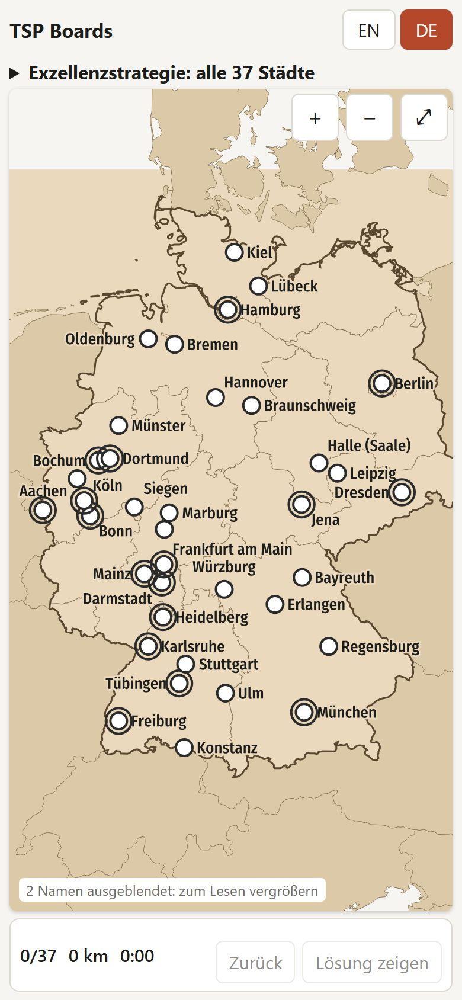
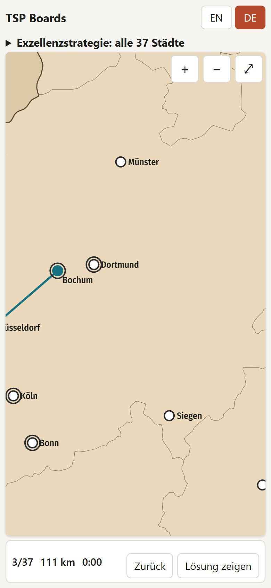
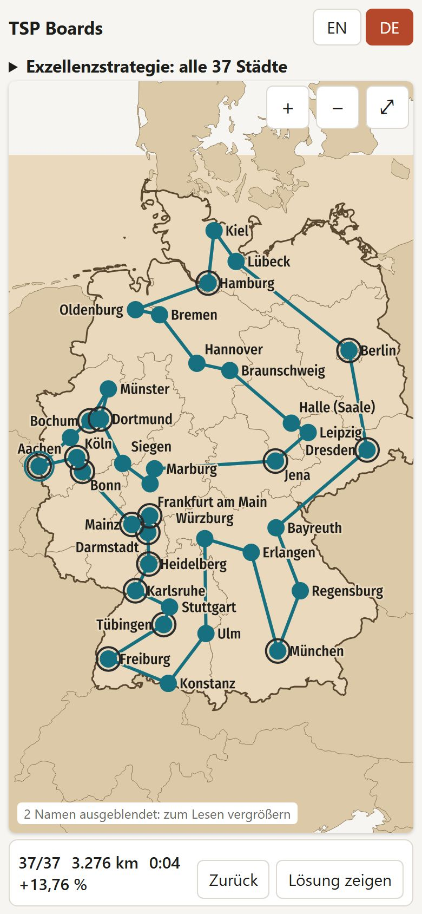
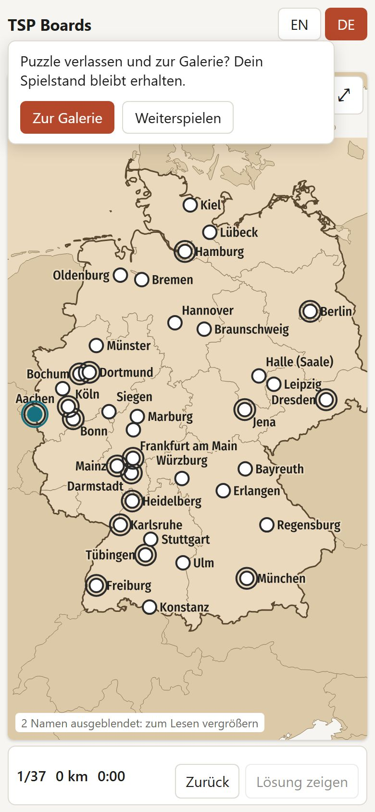

# Playing on a phone (roadmap 9.10)

`npm run e2e` (Playwright 1.63, Chromium, `e2e/phone.e2e.ts`): 390 × 844 CSS px, touch,
German, the short link `#p/exzellenzstrategie-2027-37`. The test checks the phone layout (no
sideways scrolling, the board starts within the first 120 px, the status bar is in view, the
description is folded, the hint says "Tippe"), then taps all 37 places in a 2-opt order and the
first place again, like a finger: a place off screen brings back the whole map, and a tap that
zoomed in is repeated at the place's new position. The closed trip must be judged.

Result 2026-10-17: the whole round trip by taps passes. One tap zoomed in (Bochum–Dortmund,
8 px apart at the full view), the trip was 13.76 % above the shortest one (the test's order is
2-opt, not optimal).

| Start | After an ambiguous tap | Closed trip |
| - | - | - |
|  |  |  |

Found and fixed on the way: the browser's tap highlight tinted the whole map blue at every tap
(now transparent), the status bar wrapped to a third row once the result showed (the figures
now wrap beside the buttons), and the start ring was drawn filled (an old CSS precedence bug,
also on desktops).

Added 2026-10-17 (Maike's review): on a phone the gallery button is hidden while playing, so
"TSP Boards" in the header leads to the gallery, from a puzzle after a short question; the
game is kept (second test in `e2e/phone.e2e.ts`).

