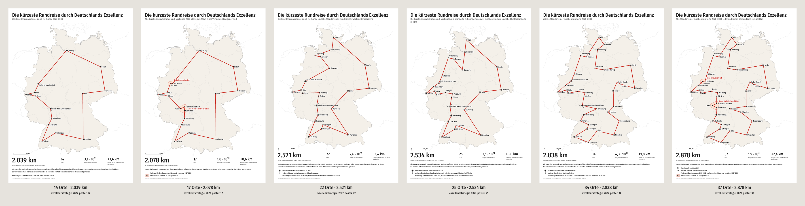

# Excellence Strategy posters (Exzellenzstrategie 2026–2033)

Six poster variants for choosing the number of places (roadmap 9.7), each DIN A1 portrait
(594 × 841 mm) as a vector PDF with a PNG preview. A poster shows the solution: the shortest
round trip through the places, drawn in red, with its length and a few facts in large type.
Lengths are great-circle kilometres ("Luftlinie"), computed and proven optimal with HiGHS.



## Comparison

| Variant                                                  | file        | Places | Length   | Second-best | Possible round trips |
| -------------------------------------------------------- | ----------- | ------ | -------- | ----------- | -------------------- |
| Universities of Excellence and alliances                 | `poster-14` | 14     | 2,039 km | +3.4 km     | 3.1 · 10⁹            |
| the same, the cities of the alliances as separate stops  | `poster-17` | 17     | 2,078 km | +0.6 km     | 1.0 · 10¹³           |
| universities plus all sites with at least two clusters   | `poster-22` | 22     | 2,521 km | +1.4 km     | 2.6 · 10¹⁹           |
| the board selection (plus all cluster sites in NRW)      | `poster-25` | 25     | 2,534 km | +8.0 km     | 3.1 · 10²³           |
| all sites of the Excellence Strategy                     | `poster-34` | 34     | 2,838 km | +1.8 km     | 4.3 · 10³⁶           |
| all sites, the cities of the alliances as separate stops | `poster-37` | 37     | 2,879 km | +2.4 km     | 1.9 · 10⁴¹           |

Files: `exzellenzstrategie-2027-poster-<n>.pdf` (print) and `.png` (preview at 30 dpi);
`report.md` has the round trip of each variant and the checks. The lengths and round-trip
counts match Kevin's check of 2026-10-16; the second-best differs by 0.1 km in two variants
(+3.4 instead of +3.5 km, +1.8 instead of +1.7 km), within the rounding of the members'
centre and of the legs.

Checks: in all six variants the shortest round trip on the flat map (the measure the app
judges against) is the same round trip as by great-circle distance; on the map it is 1.0 to
1.5 km longer. All labels are placed without overlaps.

- **14 and 34**: an alliance with universities in several cities (Ruhr Innovation Lab:
  Bochum and Dortmund; Rhein-Main-Universitäten: Darmstadt, Frankfurt, Mainz) is one stop at
  the centre of its cities, as on the board; small grey dots show the cities, and a note says
  that the tour is measured to the centre.
- **17 and 37**: each city of such an alliance is a stop of its own; a red outline with the
  alliance's name groups them.
- **22**: the board list without Düsseldorf, Münster and Siegen (no list file of its own).
- **25**: the places of the wooden board.

## Wording (German, as on the posters)

- Title: "Die kürzeste Rundreise durch Deutschlands Exzellenz".
- Subtitles: "Alle Exzellenzuniversitäten und -verbünde 2027–2033" (14), "… jede Stadt eines
  Verbunds als eigener Halt" (17, 37), "Die Exzellenzuniversitäten und -verbünde und alle
  Standorte mit mindestens zwei Exzellenzclustern" (22), "… und alle Clusterstandorte in NRW"
  (25), "Alle 34 Standorte der Exzellenzstrategie 2026–2033" (34).
- Facts: "2.534 km – ist die kürzeste Rundreise durch alle 25 Orte (Luftlinie).", "25 Orte",
  "3,1 · 10²³ mögliche Rundreisen", "+8,0 km länger ist die zweitkürzeste Rundreise", and "Die
  Rundreise wurde mit ganzzahliger linearer Optimierung (Löser HiGHS) berechnet und als
  kürzeste bewiesen: Keine andere Rundreise durch diese Orte ist kürzer."
- Footer: "Lehrstuhl 11 Algorithm Engineering, TU Dortmund · Städte: GeoNames (CC BY 4.0) ·
  Grenzen: Natural Earth · TSP Boards".

Titles, subtitles and legends are in `variants.json`; change them there and rebuild.

## Printing

Vector PDF, text as outlines, white margin of 18 mm on A1 (no bleed needed). Type scales with
the paper: on A1 the title has a cap height of about 17 mm and the length about 22 mm, both
readable from 3 m or more. Other sizes (A4 to A0) and landscape: `--paper` and
`--orientation`; the facts then go below or beside the map, whichever leaves the larger map.

## Rebuilding (and the logo versions)

Without logo (committed):

```bash
npx tsx cli/export-poster.ts --variants docs/posters/exzellenzstrategie-2027/variants.json
```

With the Ruhr Innovation Lab logo next to its place and in the legend, into the git-ignored
`local/posters/` (never into the repository):

```bash
npx tsx cli/export-poster.ts --variants docs/posters/exzellenzstrategie-2027/variants.json --out local/posters --suffix -logo --logo "Ruhr Innovation Lab=local/ruhr-innovation-lab.svg" --legend-logo local/ruhr-innovation-lab.svg
```

A single poster, e.g. A0 landscape: `npx tsx cli/export-poster.ts --puzzle
public/puzzles/exzellenzstrategie-2027.tsp.json --paper A0 --orientation landscape --out
local/posters`. The app's export panel has the same poster ("Plakat (PDF)") for any map
puzzle; a logo can be loaded there from a local SVG file and stays in the browser.
