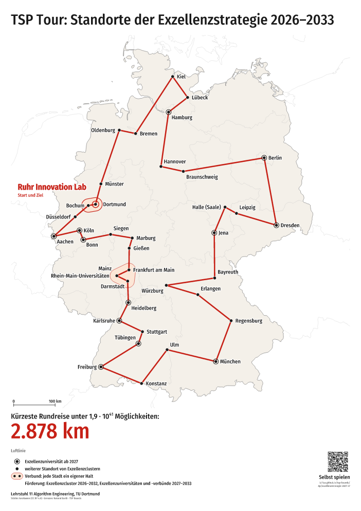

# Ruhr Innovation Lab poster (Exzellenzstrategie 2026–2033)

A poster for the corridors of Chair 11 (TU Dortmund) and of the Chair of Algorithmics (RUB)
that celebrates the Ruhr Innovation Lab (RIL) (roadmap 9.7, 9.9, 9.10): the shortest round
trip through all 37 cities of the Excellence Strategy, starting and ending at the RIL, in
German (`de/`) and English (`en/`), DIN A1 portrait as vector PDF with a PNG preview, with a
QR code to the same puzzle in the game. A0 and the versions with logos (the RIL logo, the TU
Dortmund and RUB designs) are built locally (below), never committed.



| Places | Length   | Second-best | Possible round trips | Game (QR code)                  |
| ------ | -------- | ----------- | -------------------- | ------------------------------- |
| 37     | 2,879 km | +2.4 km     | 1.9 · 10⁴¹           | `#p/exzellenzstrategie-2027-37` |

The 37 places are the Universities of Excellence and the cities of the excellence alliances
from 2027 (every city of an alliance a stop of its own) and the 20 further sites of Clusters
of Excellence 2026–2032. Until 2026-10-17 there were six variants (14, 17, 22, 25, 34 and 37
places); only the 37-city poster is kept (the others are in the git history and can be added
back to `variants.json`).

Files: `de/` and `en/` hold `exzellenzstrategie-2027-poster-37-A1.pdf` (print) and `.png`
(preview at 30 dpi); `report.md` has the order of the round trip and the checks;
`variants.json` holds the title, legend and game of both languages. The design themes are in
[`../themes/`](../themes/).

## What the poster shows

- **Title** on one line: "TSP Tour: Standorte der Exzellenzstrategie 2026–2033" / "TSP Tour:
  Sites of the Excellence Strategy 2026–2033", no subtitle.
- **The Ruhr Innovation Lab is prominent:** the round trip starts and ends there ("Start und
  Ziel" / "Start and finish", a ring at the first stop); its name is large and bold at its
  outline; Bochum and Dortmund are named dots inside the outline. With the logo (local
  versions) the RIL logo stands about 100 mm wide (A1) in free space near the outline, over the
  Netherlands, with a thin line to the outline, and replaces the name.
- **Little text:** "Kürzeste Rundreise unter 1,9 · 10⁴¹ Möglichkeiten:" / "Shortest round trip
  out of 1.9 × 10⁴¹ options:" with the number of possible round trips, (n − 1)!/2; below it,
  large, the answer (the length in km), and "Luftlinie" / "As the crow flies" in small type.
  The legend explains rings, dots and alliances (the outline: "Verbund: jede Stadt ein eigener
  Halt" / "alliance: every city a stop of its own"); notes come after the symbol lines.
- **QR code to the game,** bottom right, 40 mm wide on A1, with "Selbst spielen" / "Play it
  yourself" and the link `https://ls11ae.github.io/tsp-boards/#p/exzellenzstrategie-2027-37`,
  which opens the same places in play mode (on a phone too). The app judges this digital
  puzzle by straight lines on the map, whose shortest round trip is the poster's.
- **Labels keep off the round trip:** no label covers a leg, an outline of another alliance or
  the logo, and each name sits clearly next to its own dot: nearer to it than to any other dot
  or outline, and a name above, below or at a corner of its dot keeps other names away, so
  that Würzburg does not read as a city of the Rhine-Main alliance (checked for all files; see
  `report.md`, column "labels unclear").
- **German and English:** English uses the official terms (Excellence Strategy, Universities of
  Excellence, Clusters of Excellence, excellence alliance, Rhine-Main Universities), English
  place names where they are common (Munich, Cologne, Hanover) and the English number format
  (2,879 km; 1.9 × 10⁴¹).
- **Footer:** the chair line in large type (cap height about 5 mm on A1), the data credits
  below.

Checks: the shortest round trip on the flat map (the measure the app judges against) is the
same round trip as by great-circle distance (about 1.5 km longer on the map). The length and
the round-trip count match Kevin's check of 2026-10-16.

## Design themes

`--theme` picks a design from [`../themes/`](../themes/) (colours, logo file names, clear
space, sender line; the logos themselves come only from `local/`):

- **neutral** (the committed posters): dark title, red round trip and length, no logos.
- **tu** (Kevin's corridor): the TU Dortmund logo at the top left with clear space (the English
  logo on English posters), title and length in TU green, the round trip red, the faculty logo
  at the bottom left and the AE logo at the bottom right.
- **rub** (the corridor of the Chair of Algorithmics): the RUB logo at the top right, title,
  length and round trip in RUB blue, a light blue tint inside alliances, the Faculty of
  Computer Science logo at the bottom left and "Lehrstuhl für Algorithmik, Ruhr-Universität
  Bochum" / "Chair of Algorithmics, Ruhr University Bochum" as the sender line; no chair logo.

Logos at the top and in the footer keep their colours, fills and strokes (lines at least
0.25 mm wide); logos on the map stay one colour. The font stays Fira Sans Condensed.

## Printing

Vector PDF, text as outlines, white margin of 18 mm on A1 (no bleed needed). Type and lines
scale with the paper, so A0 is A1 enlarged by √2: on A1 the title has a cap height of about
17 mm and the length about 25 mm, readable from 3 m or more.

## Rebuilding

The committed A1 versions in German and English, neutral, with the QR code:

```bash
npx tsx cli/export-poster.ts --variants docs/posters/exzellenzstrategie-2027/variants.json
```

The local versions go into the git-ignored `local/posters/` (a link to the shared folder
`tsp-boards-local`; the logo files are in `local/`, see `local/LIESMICH-logo.txt`; never
commit them or files containing them). The TU Dortmund and RUB designs with the RIL logo, A1
and A0:

```bash
npx tsx cli/export-poster.ts --variants docs/posters/exzellenzstrategie-2027/variants.json --out local/posters --paper A1,A0 --theme tu,rub --logo "Ruhr Innovation Lab=local/ruhr-innovation-lab-textur.svg"
```

This writes `local/posters/<de|en>/exzellenzstrategie-2027-poster-37-<A1|A0>-<tu|rub>.pdf`
(and `.png`) and `report-tu.md`, `report-rub.md`. The
neutral design with the RIL logo and the TU logo at the bottom right (`-logo`), and the neutral
A0 without logos:

```bash
npx tsx cli/export-poster.ts --variants docs/posters/exzellenzstrategie-2027/variants.json --out local/posters --paper A1,A0 --also-plain --suffix -logo --logo "Ruhr Innovation Lab=local/ruhr-innovation-lab-textur.svg" --corner-logo local/tu-dortmund.svg
```

A missing logo file is reported, and the posters are built without it.

The app's export panel makes the neutral poster ("Plakat (PDF)") for any map puzzle, in the
app's language, with title, subtitle and legend editable before the export, any place to
emphasize and the QR code for gallery puzzles; its logo can be loaded from a local SVG file
and stays in the browser.
