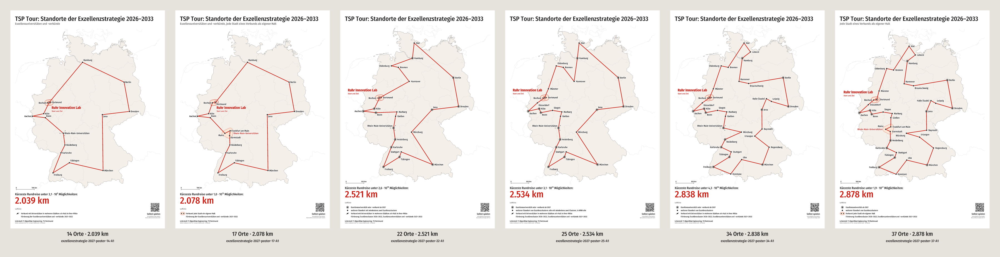

# Ruhr Innovation Lab posters (Exzellenzstrategie 2026–2033)

Posters for the corridors of Chair 11 (TU Dortmund) and of Maike's chair (RUB) that celebrate
the Ruhr Innovation Lab (RIL) (roadmap 9.7, 9.9, 9.10): the shortest round trip through the
sites of the Excellence Strategy, starting and ending at the RIL. Six variants for choosing the
number of places, each in German (`de/`) and English (`en/`), DIN A1 portrait as vector PDF
with a PNG preview, with a QR code to the same puzzle in the game. A0 and the versions with
logos (the RIL logo, the TU Dortmund and RUB designs) are built locally (below), never
committed.



## The variants

| Variant                                                                | file        | Places | Length   | Second-best | Possible round trips | Game (QR code)                            |
| ---------------------------------------------------------------------- | ----------- | ------ | -------- | ----------- | -------------------- | ----------------------------------------- |
| Universities of Excellence and alliances                               | `poster-14` | 14     | 2,039 km | +3.4 km     | 3.1 · 10⁹            | `#p/exzellenzuniversitaeten-2027`         |
| the same, every city of an alliance a stop of its own                  | `poster-17` | 17     | 2,078 km | +0.6 km     | 1.0 · 10¹³           | `#p/exzellenzuniversitaeten-2027-staedte` |
| universities plus all sites with at least two Clusters of Excellence   | `poster-22` | 22     | 2,521 km | +1.4 km     | 2.6 · 10¹⁹           | `#p/exzellenzstrategie-2027-22`           |
| the board selection (plus all cluster sites in North Rhine-Westphalia) | `poster-25` | 25     | 2,534 km | +8.0 km     | 3.1 · 10²³           | `#p/exzellenzstrategie-2027-brett`        |
| all sites of the Excellence Strategy                                   | `poster-34` | 34     | 2,838 km | +1.8 km     | 4.3 · 10³⁶           | `#p/exzellenzstrategie-2027`              |
| all sites, every city of an alliance a stop of its own                 | `poster-37` | 37     | 2,879 km | +2.4 km     | 1.9 · 10⁴¹           | `#p/exzellenzstrategie-2027-37`           |

Files: `de/` and `en/` hold `exzellenzstrategie-2027-poster-<n>-A1.pdf` (print) and `.png`
(preview at 30 dpi) and one contact sheet each (`exzellenzstrategie-2027-varianten-A1.png`);
`report.md` has the order of each round trip and the checks; `variants.json` holds the titles,
subtitles, legends and games of both languages. The design themes are in
[`../themes/`](../themes/).

## What the posters show

- **Title** on one line: "TSP Tour: Standorte der Exzellenzstrategie 2026–2033" / "TSP Tour:
  Sites of the Excellence Strategy 2026–2033"; a short subtitle only where the variant needs
  one (14 and 17: only the universities; 17 and 37: every city of an alliance a stop of its
  own).
- **The Ruhr Innovation Lab is prominent:** the round trip starts and ends there ("Start und
  Ziel" / "Start and finish", a ring at the first stop); its name is large and bold at its
  outline; Bochum and Dortmund are named dots inside the outline, also where the RIL is one
  stop at their centre (14, 22, 25, 34). With the logo (local versions) the RIL logo stands
  about 100 mm wide (A1) in free space near the outline, over the Netherlands, with a thin line
  to the outline, and replaces the name.
- **Little text:** "Kürzeste Rundreise unter 4,3 · 10³⁶ Möglichkeiten:" / "Shortest round trip
  out of 4.3 × 10³⁶ options:" with the number of possible round trips, (n − 1)!/2; below it,
  large, the answer (the length in km), and "Luftlinie" / "As the crow flies" in small type.
  The legend explains rings, dots and alliances; notes come after the symbol lines.
- **QR code to the game,** bottom right, 40 mm wide on A1, with "Selbst spielen" / "Play it
  yourself" and the link: `https://ls11ae.github.io/tsp-boards/#p/<puzzle id>` opens the same
  places in play mode (on a phone too). The app judges digital puzzles by straight lines on the
  map, whose shortest round trip is the poster's in all six variants; the board puzzle (25) by
  string, whose optimum is the same round trip.
- **Labels keep off the round trip:** no label covers a leg, an outline of another alliance or
  the logo, and each name sits clearly next to its own dot (checked for all files; see
  `report.md`).
- **German and English:** English uses the official terms (Excellence Strategy, Universities of
  Excellence, Clusters of Excellence, excellence alliance, Rhine-Main Universities), English
  place names where they are common (Munich, Cologne, Hanover) and the English number format
  (2,534 km; 3.1 × 10²³).
- **Footer:** the chair line in large type (cap height about 5 mm on A1), the data credits
  below.

Checks: in all six variants the shortest round trip on the flat map (the measure the app
judges against) is the same round trip as by great-circle distance (1.0–1.5 km longer on the
map). The lengths and round-trip counts match Kevin's check of 2026-10-16; the second-best
differs by 0.1 km in two variants, from rounding.

## Design themes

`--theme` picks a design from [`../themes/`](../themes/) (colours, logo file names, clear
space, sender line; the logos themselves come only from `local/`):

- **neutral** (the committed posters): dark title, red round trip and length, no logos.
- **tu** (Kevin's corridor): the TU Dortmund logo at the top left with clear space (the English
  logo on English posters), title and length in TU green, the round trip red, the faculty logo
  at the bottom left and the AE logo at the bottom right.
- **rub** (Maike's corridor): the RUB logo at the top right, title, length and round trip in
  RUB blue, a light blue tint inside alliances, the Faculty of Computer Science logo at the
  bottom left and the chair logo at the bottom right. The sender line is a placeholder until
  its text is known: change `sender` in `../themes/rub.json`.

Logos at the top and in the footer keep their colours, fills and strokes (lines at least
0.25 mm wide); logos on the map stay one colour. The font stays Fira Sans Condensed.

## Printing

Vector PDF, text as outlines, white margin of 18 mm on A1 (no bleed needed). Type and lines
scale with the paper, so A0 is A1 enlarged by √2: on A1 the title has a cap height of about
17 mm and the length about 25 mm, readable from 3 m or more.

## Rebuilding

The committed A1 versions in German and English, neutral, with the QR code:

```bash
npx tsx cli/export-poster.ts --variants docs/posters/exzellenzstrategie-2027/variants.json
```

The local versions go into the git-ignored `local/posters/` (a link to the shared folder
`tsp-boards-local`; the logo files are in `local/`, see `local/LIESMICH-logo.txt`; never
commit them or files containing them). The TU Dortmund and RUB designs with the RIL logo, A1
and A0:

```bash
npx tsx cli/export-poster.ts --variants docs/posters/exzellenzstrategie-2027/variants.json --out local/posters --paper A1,A0 --theme tu,rub --logo "Ruhr Innovation Lab=local/ruhr-innovation-lab-textur.svg"
```

This writes `local/posters/<de|en>/exzellenzstrategie-2027-poster-<n>-<A1|A0>-<tu|rub>.pdf`
(and `.png`), contact sheets per language and paper, and `report-tu.md`, `report-rub.md`. The
neutral design with the RIL logo and the TU logo at the bottom right (`-logo`), and the neutral
A0 without logos:

```bash
npx tsx cli/export-poster.ts --variants docs/posters/exzellenzstrategie-2027/variants.json --out local/posters --paper A1,A0 --also-plain --suffix -logo --logo "Ruhr Innovation Lab=local/ruhr-innovation-lab-textur.svg" --corner-logo local/tu-dortmund.svg
```

A missing logo file is reported, and the posters are built without it.

The app's export panel makes the neutral poster ("Plakat (PDF)") for any map puzzle, in the
app's language, with title, subtitle and legend editable before the export, any place to
emphasize and the QR code for gallery puzzles; its logo can be loaded from a local SVG file
and stays in the browser.
